# Ablauf Stations-Check

Automatisch aus `index.html` (Block `FLOW`) erzeugt. Grün = einsatzbereit, rot = Techniker, orange = Dorian.
Gestrichelte Pfeile: „Nein (2. Mal)" = dieselbe Frage zum zweiten Mal mit Nein beantwortet; „Nein, Strom schon geprüft" = der Abschnitt Stromversorgung wurde in diesem Durchlauf schon durchlaufen.

Zu Beginn wird das Ziel gewählt (Netz- oder Batteriebetrieb); die Stromversorgung prüft danach automatisch den passenden Betrieb.

Die Docker-Abfrage nach dem Anmelden hängt von der Station ab (`config.js`: `DOCKER_MIT_ABFRAGE` / `DOCKER_OHNE_ABFRAGE`).

## Geprüft

- Alle 79 Schritte erreichbar, keine Sackgassen.
- Alle 12 Ergebnisse erreichbar.
- Keine Endlosschleifen: über 56 Millionen mögliche Wege, jeder endet bei einem Ergebnis.

```mermaid
flowchart TD
DW{{"Docker-Verhalten der Station"}}
GOAL{"Ziel: Netz- oder Batteriebetrieb?"}
BM{{"Ziel vom Anfang"}}
subgraph S0["1 – Beleuchtung"]
  GOAL{"Wofür soll die Station laufen?"}
  LP{"Welche LED-Panels leuchten?"}
  FC{"Leuchtet das vordere Panel in WBK-Grün?"}
  FC1["Farbe mit der Fernbedienung auf WBK-Grün einstellen."]
  TM1["Hinweis: Bitte einen Techniker informieren."]
  FB["Fernbedienung aus dem Büro von Fabian Hofsäß holen und die…"]
  FB2{"Leuchtet das vordere Panel jetzt?"}
  TM2["Hinweis: Bitte einen Techniker informieren."]
end
subgraph S1["2 – Stromversorgung"]
  E{"Ist der Notaus gedrückt?"}
  E1["Notaus durch Ziehen nach oben lösen."]
  F{"Vordere Tür durch Ziehen öffnen. Ist der Hauptschalter aus?"}
  F1["Hauptschalter einschalten."]
  G["Grünen Knopf oben rechts an der Arbeitsstation drücken."]
  H{"Leuchtet die Kontroll-LED?"}
  NK0{"Steckt das Netzkabel hinten an der Station und in der Stec…"}
  K0["Netzkabel hinten an der Station und in der Steckdose einst…"]
  PT0{"Kam nach dem Einstecken ein sich wiederholender Piepton?"}
  H2{"Grünen Knopf nochmal drücken. Leuchtet die Kontroll-LED je…"}
  NK{"Steckt das Netzkabel hinten an der Station und in der Stec…"}
  K["Netzkabel hinten an der Station und in der Steckdose einst…"]
  PT{"Kam nach dem Einstecken ein sich wiederholender Piepton?"}
  NA{"Anzeige hinter der vorderen Tür: Bewegen sich 2 Pfeile (li…"}
  BA{"Was zeigt die Anzeige hinter der vorderen Tür?"}
  BU["Für den Batteriebetrieb das Netzkabel hinten an der Statio…"]
  BV{"Zeigt die Anzeige eine Batteriespannung über 24 V?"}
  BL["Hinweis: Die Batterie ist zu schwach."]
end
subgraph S2["3 – Monitor & PC"]
  C{"Leuchtet die LED am Monitor?"}
  B["Power-Schalter am Monitor einmal drücken."]
  C2{"Leuchtet die Monitor-LED jetzt?"}
  MK{"Steckt das Stromkabel hinten am Monitor fest?"}
  MK1["Stromkabel hinten am Monitor fest einstecken."]
  C3{"Leuchtet die Monitor-LED jetzt?"}
  P{"Zeigt der Monitor ein normales Bild?"}
  N{"Ist der NUC-PC an?"}
  N1["NUC-PC einschalten und warten, bis er hochgefahren ist (ca…"]
  NW{"Leuchtet die LED am NUC-PC?"}
  NC{"Steckt das Stromkabel am NUC-PC fest?"}
  NC1["Stromkabel am NUC-PC fest einstecken, NUC einschalten und …"]
  NW2{"Leuchtet die LED am NUC-PC jetzt?"}
  HD["HDMI-Kabel an Monitor und NUC-PC prüfen und fest einstecken."]
  HB{"Ist jetzt ein Bild da?"}
  TO{"Den Sperrbildschirm mit dem Finger nach oben wegwischen. R…"}
  TO1["Monitor mit dem Power-Schalter aus- und wieder einschalten."]
  TO2{"Nochmal nach oben wischen. Reagiert der Touch jetzt?"}
  TO3["Kabel hinten am Monitor abziehen und wieder fest einstecken."]
  TO4{"Nochmal nach oben wischen. Reagiert der Touch jetzt?"}
  LOG["Falls nötig: mit dem Benutzer Lernfabrik und dem Lernfabri…"]
end
subgraph S3["4 – Docker & MES"]
  DWA{"Nach dem Anmelden bis zu 30 Sekunden warten. Erscheint die…"}
  DWN{"Nach dem Anmelden bis zu 30 Sekunden warten. Startet Docke…"}
  DWU{"Nach dem Anmelden bis zu 30 Sekunden warten. Was passiert …"}
  DWY["Abfrage mit Ja bestätigen und kurz warten, bis Docker läuft."]
  DA["Docker als Administrator starten, die Abfrage mit Ja bestä…"]
  R1["Einen Pol-Topf in die Aufnahme am RFID-Reader einlegen."]
  R2{"Was leuchtet am RFID-Reader?"}
  SL{"Leuchtet das Smart-Light oben grün?"}
  DK1{"Am PC: Ist Docker automatisch gestartet?"}
  DK2["Docker als Administrator ausführen, die Admin-Abfrage best…"]
  TA{"Pol-Topf erneut einlegen: Leuchtet der RFID-Reader grün un…"}
  DK3["In Docker auf den dunkelblauen Start-Pfeil drücken und war…"]
  TB{"Pol-Topf erneut einlegen: Leuchtet der RFID-Reader grün un…"}
  RS["PC einmal neu starten und danach erneut anmelden."]
  TC{"Pol-Topf erneut einlegen: Leuchtet der RFID-Reader grün un…"}
  IO{"Leuchtet der IO-Link-Master?"}
  KA{"Sind alle Kabel am IO-Link-Master eingesteckt?"}
  KA1["Kabel einstecken. Wenn die Position unklar ist, mit einer …"]
end
MES(["Station voll einsatzbereit"])
TM3(["Techniker rufen: Station bekommt keinen Strom"])
TM4(["Techniker rufen: Station lädt nicht am Netz"])
TM5(["Techniker rufen: Monitor geht nicht an"])
TM6(["Techniker rufen: Kein Bild trotz PC und HDMI"])
TM7(["Techniker rufen: IO-Link-Master ohne Strom"])
TM8(["Techniker rufen: NUC-PC lässt sich nicht einschalten"])
TM9(["Techniker rufen: Touch funktioniert nicht"])
DOR3(["Dorian melden: Smart-Light wird trotz laufendem Docker nicht grün"])
DOR4(["Dorian melden: IO-Link-Kabel: richtige Position unklar"])
DOR1(["Dorian melden: Docker läuft auch nach PC-Neustart nicht"])
DOR2(["Dorian melden: RFID reagiert trotz gesteckter Kabel nicht"])
GOAL -->|"Netzbetrieb (Führung / Schulung im Layout)"| LP
GOAL -->|"Batteriebetrieb (Stationen frei verteilt)"| LP
LP -->|"Beide"| FC
LP -->|"Nur vorne, oben aus"| TM1
LP -->|"Nur oben, vorne aus"| FB
LP -->|"Keins"| E
FC -->|Ja| C
FC -->|Nein| FC1
FC1 --> C
TM1 --> C
FB --> FB2
FB2 -->|Ja| FC
FB2 -->|Nein| TM2
TM2 --> C
E -->|Ja| E1
E -->|Nein| F
E1 --> F
F -->|Ja| F1
F -->|Nein| G
F1 --> G
G --> H
H -->|Ja| BM
H -->|Nein| NK0
NK0 -->|Ja| TM3
NK0 -->|Nein| K0
K0 --> PT0
PT0 -->|Ja| H2
PT0 -->|Nein| H2
H2 -->|Ja| NA
H2 -->|Nein| TM3
BM -.->|"Station: unbekannt"| NK
BM -.->|"Station: unbekannt"| BA
NK -->|Ja| NA
NK -->|Nein| K
K --> PT
PT -->|Ja| NA
PT -->|Nein| NA
NA -->|Ja| C
NA -->|Nein| TM4
BA -->|"1 Pfeil (Mitte → rechts)"| BV
BA -->|"2 Pfeile (Kabel steckt noch)"| BU
BA -->|"Keine Pfeile / Anzeige aus"| TM3
BU --> BV
BV -->|Ja| C
BV -->|Nein| BL
BL --> K
C -->|Ja| P
C -->|Nein| B
B --> C2
C2 -->|Ja| P
C2 -->|Nein| E
C2 -.->|"Nein, Strom schon geprüft"| MK
MK -->|Ja| TM5
MK -->|Nein| MK1
MK1 --> C3
C3 -->|Ja| P
C3 -->|Nein| TM5
P -->|Ja| TO
P -->|Nein| N
N -->|Ja| HD
N -->|Nein| N1
N -.->|"Nein (2. Mal)"| NC
N1 --> NW
NW -->|Ja| P
NW -->|Nein| E
NW -.->|"Nein, Strom schon geprüft"| NC
NC -->|Ja| TM8
NC -->|Nein| NC1
NC -.->|"Nein (2. Mal)"| TM8
NC1 --> NW2
NW2 -->|Ja| P
NW2 -->|Nein| TM8
HD --> HB
HB -->|Ja| TO
HB -->|Nein| TM6
TO -->|Ja| LOG
TO -->|Nein| TO1
TO1 --> TO2
TO2 -->|Ja| LOG
TO2 -->|Nein| TO3
TO3 --> TO4
TO4 -->|Ja| LOG
TO4 -->|Nein| TM9
LOG --> DW
DW -.->|"Station: mit Abfrage"| DWA
DW -.->|"Station: ohne Abfrage"| DWN
DW -.->|"Station: unbekannt"| DWU
DWA -->|Ja| DWY
DWA -->|Nein| DA
DWN -->|Ja| R1
DWN -->|Nein| DA
DWU -->|"Eine Abfrage erscheint"| DWY
DWU -->|"Docker startet ohne Abfrage"| R1
DWU -->|"Nichts passiert"| DA
DWY --> R1
DA --> R1
R1 --> R2
R2 -->|"Grün und Orange"| SL
R2 -->|"Nur Grün"| DK1
R2 -->|"Gar nichts"| IO
SL -->|Ja| MES
SL -->|Nein| DK1
SL -.->|"Nein (2. Mal)"| DOR3
DK1 -->|Ja| DK3
DK1 -->|Nein| DK2
DK2 --> TA
TA -->|Ja| SL
TA -->|Nein| DK3
DK3 --> TB
TB -->|Ja| SL
TB -->|Nein| RS
RS --> TC
TC -->|Ja| SL
TC -->|Nein| DOR1
IO -->|Ja| KA
IO -->|Nein| TM7
KA -->|Ja| DOR2
KA -->|Nein| KA1
KA -.->|"Nein (2. Mal)"| DOR4
KA1 --> R1
classDef ok fill:#e1f1e0,stroke:#2f7d32,color:#173404
classDef tech fill:#f8e0dc,stroke:#c0392b,color:#501313
classDef dorian fill:#fbecd3,stroke:#b26a00,color:#412402
class MES ok
class TM3,TM4,TM5,TM6,TM7,TM8,TM9 tech
class DOR3,DOR4,DOR1,DOR2 dorian

```

