# Ablauf Stations-Check

Automatisch aus `index.html` (Block `FLOW`) erzeugt. Grün = einsatzbereit, rot = Techniker, orange = Dorian.
Gestrichelte Pfeile: Wird dieselbe Frage im selben Durchlauf ein zweites Mal mit „Nein" beantwortet, geht es dorthin (verhindert Endlosschleifen).

## Geprüft

- Alle 50 Schritte sind erreichbar, keine Sackgassen.
- Alle 11 Ergebnisse sind erreichbar.
- Keine Endlosschleifen: Jeder der 18.590 möglichen Wege endet bei einem Ergebnis.

```mermaid
flowchart TD
subgraph S0["1 – Beleuchtung"]
  LP{"Welche LED-Panels leuchten?"}
  FC{"Leuchtet das vordere Panel in WBK-Grün?"}
  FC1["Farbe mit der Fernbedienung auf WBK-Grün einstellen."]
  TM1["Hinweis: Bitte einen Techniker informieren."]
  FB["Fernbedienung aus dem Büro von Fabian Hofsäß holen und die…"]
  FB2{"Leuchtet das vordere Panel jetzt?"}
  TM2["Hinweis: Bitte einen Techniker informieren."]
end
subgraph S1["2 – Stromversorgung"]
  E{"Ist der Notaus gedrückt?"}
  E1["Notaus durch Ziehen nach oben lösen."]
  F{"Vordere Tür durch Ziehen öffnen. Ist der Hauptschalter aus?"}
  F1["Hauptschalter einschalten."]
  G["Grünen Knopf oben rechts an der Arbeitsstation drücken."]
  H{"Leuchtet die Kontroll-LED?"}
  M{"Leuchtet die LED am Monitor?"}
  I{"Was zeigt die Batterieanzeige hinter der vorderen Tür?"}
  K["Die Station läuft im Batteriebetrieb. Netzkabel hinten an …"]
  L{"Bewegt sich jetzt auch der 2. Pfeil (links → Mitte)?"}
end
subgraph S2["3 – Monitor & PC"]
  C{"Leuchtet die LED am Monitor?"}
  B["Power-Schalter am Monitor einmal drücken."]
  C2{"Leuchtet die Monitor-LED jetzt?"}
  P{"Zeigt der Monitor ein normales Bild?"}
  N{"Ist der NUC-PC an?"}
  N1["NUC-PC einschalten."]
  HD["HDMI-Kabel an Monitor und NUC-PC prüfen und fest einstecken."]
  HB{"Ist jetzt ein Bild da?"}
  LOG["Falls nötig: per Touch mit dem Benutzer Lernfabrik und dem…"]
end
subgraph S3["4 – Docker & MES"]
  R1["Einen Pol-Topf an den RFID-Reader halten."]
  R2{"Was leuchtet am RFID-Reader?"}
  SL{"Leuchtet das Smart-Light oben grün?"}
  DK1{"Am PC: Ist Docker automatisch gestartet?"}
  DK2["Docker als Administrator ausführen, die Admin-Abfrage best…"]
  TA{"Pol-Topf erneut anhalten: Leuchtet der RFID-Reader grün un…"}
  DK3["In Docker auf den dunkelblauen Start-Pfeil drücken und war…"]
  TB{"Pol-Topf erneut anhalten: Leuchtet der RFID-Reader grün un…"}
  RS["PC einmal neu starten und danach erneut anmelden."]
  TC{"Pol-Topf erneut anhalten: Leuchtet der RFID-Reader grün un…"}
  IO{"Leuchtet der IO-Link-Master?"}
  KA{"Sind alle Kabel am IO-Link-Master eingesteckt?"}
  KA1["Kabel einstecken. Wenn die Position unklar ist, mit einer …"]
end
MES(["Station voll einsatzbereit"])
TM3(["Techniker rufen: Station bekommt keinen Strom"])
TM4(["Techniker rufen: Station lädt nicht am Netz"])
TM5(["Techniker rufen: Monitor geht nicht an"])
TM6(["Techniker rufen: Kein Bild trotz PC und HDMI"])
TM7(["Techniker rufen: IO-Link-Master ohne Strom"])
TM8(["Techniker rufen: NUC-PC lässt sich nicht einschalten"])
DOR3(["Dorian melden: Smart-Light wird trotz laufendem Docker nicht grün"])
DOR4(["Dorian melden: IO-Link-Kabel: richtige Position unklar"])
DOR1(["Dorian melden: Docker läuft auch nach PC-Neustart nicht"])
DOR2(["Dorian melden: RFID reagiert trotz gesteckter Kabel nicht"])
LP -->|"Beide"| FC
LP -->|"Nur vorne, oben aus"| TM1
LP -->|"Nur oben, vorne aus"| FB
LP -->|"Keins"| E
FC -->|Ja| C
FC -->|Nein| FC1
FC1 --> C
TM1 --> C
FB --> FB2
FB2 -->|Ja| FC
FB2 -->|Nein| TM2
TM2 --> C
E -->|Ja| E1
E -->|Nein| F
E1 --> F
F -->|Ja| F1
F -->|Nein| G
F1 --> G
G --> H
H -->|Ja| M
H -->|Nein| I
M -->|Ja| P
M -->|Nein| B
I -->|"Smiley, 2 Pfeile bewegen sich"| TM3
I -->|"Nur 1 Pfeil (Mitte → rechts)"| K
I -->|"Anzeige aus oder etwas anderes"| TM3
K --> L
L -->|Ja| C
L -->|Nein| TM4
C -->|Ja| P
C -->|Nein| B
B --> C2
C2 -->|Ja| P
C2 -->|Nein| TM5
P -->|Ja| LOG
P -->|Nein| N
N -->|Ja| HD
N -->|Nein| N1
N -.->|"Nein (2. Mal)"| TM8
N1 --> P
HD --> HB
HB -->|Ja| LOG
HB -->|Nein| TM6
LOG --> R1
R1 --> R2
R2 -->|"Grün und Orange"| SL
R2 -->|"Nur Grün"| DK1
R2 -->|"Gar nichts"| IO
SL -->|Ja| MES
SL -->|Nein| DK1
SL -.->|"Nein (2. Mal)"| DOR3
DK1 -->|Ja| DK3
DK1 -->|Nein| DK2
DK2 --> TA
TA -->|Ja| SL
TA -->|Nein| DK3
DK3 --> TB
TB -->|Ja| SL
TB -->|Nein| RS
RS --> TC
TC -->|Ja| SL
TC -->|Nein| DOR1
IO -->|Ja| KA
IO -->|Nein| TM7
KA -->|Ja| DOR2
KA -->|Nein| KA1
KA -.->|"Nein (2. Mal)"| DOR4
KA1 --> R1
classDef ok fill:#e1f1e0,stroke:#2f7d32,color:#173404
classDef tech fill:#f8e0dc,stroke:#c0392b,color:#501313
classDef dorian fill:#fbecd3,stroke:#b26a00,color:#412402
class MES ok
class TM3,TM4,TM5,TM6,TM7,TM8 tech
class DOR3,DOR4,DOR1,DOR2 dorian

```

