# Ablauf Stations-Check

Automatisch aus `index.html` (Block `FLOW`) erzeugt. Grün = einsatzbereit, rot = Techniker, orange = Dorian.
Gestrichelte Pfeile: „Nein (2. Mal)" = dieselbe Frage zum zweiten Mal mit Nein beantwortet; „Nein, Strom schon geprüft" = der Abschnitt Stromversorgung wurde in diesem Durchlauf schon durchlaufen.

Zu Beginn wird das Ziel gewählt (Netz- oder Batteriebetrieb); die Stromversorgung prüft danach automatisch den passenden Betrieb.

Nach Strom, PC und Docker wird gefragt, wofür das MES genutzt wird: Besuchstermin (MES im Vollbild) oder eine der fünf Schulungen. Die Schulungs-Abläufe sind als Platzhalter angelegt und werden noch ausgearbeitet.

Die Docker-Abfrage nach dem Anmelden hängt von der Station ab (`config.js`: `DOCKER_MIT_ABFRAGE` / `DOCKER_OHNE_ABFRAGE`).

Linux-Stationen (`LINUX_STATIONS`, aktuell Pressen 1): Docker startet dort immer selbst mit Admin-Rechten, der Docker-Schritt entfällt. Wird der Pol-Topf nicht erkannt, geht es direkt zu Dorian, weil man dort nichts selbst beheben kann.

## MES-Guide

Eigener Einstieg über `?m=mes` (QR-Code „MES vorbereiten"), wenn die Stationen schon laufen. Inhalt nach `docs/Anleitung_MES.pdf`:
Schulung allgemein (Training, Spielrunde, Stationen, Werker, RFID-Test), Demo/Besuch (Demo-Modus, Vollbild), Werker an der Station, Kommissionierer, Kunde.
Aus dem Stations-Check führen die Schulungen in denselben Ablauf und danach zum Platzhalter der jeweiligen Schulung.

## Geprüft

- Alle 131 Schritte erreichbar, keine Sackgassen.
- Alle 19 Ergebnisse erreichbar.
- Keine Endlosschleifen (Zustandsanalyse über alle 5.655 möglichen Zustände).

```mermaid
flowchart TD
DW{{"Docker-Verhalten der Station"}}
OSR{{"Linux oder Windows?"}}
MG{"MES-Guide: Was vorbereiten?"}
GSW{{"Demo oder Schulung"}}
GTR{{"Gewählte Schulung"}}
GOAL{"Ziel: Netz- oder Batteriebetrieb?"}
BM{{"Ziel vom Anfang"}}
subgraph S0["1 – Beleuchtung"]
  GOAL{"Wofür soll die Station laufen?"}
  LP{"Welche LED-Panels leuchten?"}
  FC{"Leuchtet das vordere Panel in WBK-Grün?"}
  FC1["Farbe mit der Fernbedienung auf WBK-Grün einstellen."]
  TM1["Hinweis: Bitte einen Techniker informieren."]
  FB["Fernbedienung aus dem Büro von Fabian Hofsäß holen und die…"]
  FB2{"Leuchtet das vordere Panel jetzt?"}
  TM2["Hinweis: Bitte einen Techniker informieren."]
end
subgraph S1["2 – Stromversorgung"]
  E{"Ist der Notaus gedrückt?"}
  E1["Notaus durch Ziehen nach oben lösen."]
  F{"Vordere Tür durch Ziehen öffnen. Ist der Hauptschalter aus?"}
  F1["Hauptschalter einschalten."]
  G["Grünen Knopf oben rechts an der Arbeitsstation drücken."]
  H{"Leuchtet die Kontroll-LED?"}
  NK0{"Steckt das Netzkabel hinten an der Station und in der Stec…"}
  K0["Netzkabel hinten an der Station und in der Steckdose einst…"]
  PT0{"Kam nach dem Einstecken ein sich wiederholender Piepton?"}
  H2{"Grünen Knopf nochmal drücken. Leuchtet die Kontroll-LED je…"}
  NK{"Steckt das Netzkabel hinten an der Station und in der Stec…"}
  K["Netzkabel hinten an der Station und in der Steckdose einst…"]
  PT{"Kam nach dem Einstecken ein sich wiederholender Piepton?"}
  NA{"Anzeige hinter der vorderen Tür: Bewegen sich 2 Pfeile (li…"}
  BA{"Was zeigt die Anzeige hinter der vorderen Tür?"}
  BU["Für den Batteriebetrieb das Netzkabel hinten an der Statio…"]
  BV{"Zeigt die Anzeige eine Batteriespannung über 24 V?"}
  BL["Hinweis: Die Batterie ist zu schwach."]
end
subgraph S2["3 – Monitor & PC"]
  C{"Leuchtet die LED am Monitor?"}
  B["Power-Schalter am Monitor einmal drücken."]
  C2{"Leuchtet die Monitor-LED jetzt?"}
  MK{"Steckt das Stromkabel hinten am Monitor fest?"}
  MK1["Stromkabel hinten am Monitor fest einstecken."]
  C3{"Leuchtet die Monitor-LED jetzt?"}
  P{"Zeigt der Monitor ein normales Bild?"}
  N{"Ist der NUC-PC an?"}
  N1["NUC-PC einschalten und warten, bis er hochgefahren ist (ca…"]
  NW{"Leuchtet die LED am NUC-PC?"}
  NC{"Steckt das Stromkabel am NUC-PC fest?"}
  NC1["Stromkabel am NUC-PC fest einstecken, NUC einschalten und …"]
  NW2{"Leuchtet die LED am NUC-PC jetzt?"}
  HD["HDMI-Kabel an Monitor und NUC-PC prüfen und fest einstecken."]
  HB{"Ist jetzt ein Bild da?"}
  TO{"Den Sperrbildschirm mit dem Finger nach oben wegwischen. R…"}
  TO1["Monitor mit dem Power-Schalter aus- und wieder einschalten."]
  TO2{"Nochmal nach oben wischen. Reagiert der Touch jetzt?"}
  TO3["Kabel hinten am Monitor abziehen und wieder fest einstecken."]
  TO4{"Nochmal nach oben wischen. Reagiert der Touch jetzt?"}
  LOG["Falls nötig: mit dem Benutzer Lernfabrik und dem Passwort …"]
end
subgraph S3["4 – Docker & MES"]
  DWA{"Nach dem Anmelden bis zu 30 Sekunden warten. Erscheint die…"}
  DWN{"Nach dem Anmelden bis zu 30 Sekunden warten. Startet Docke…"}
  DWU{"Nach dem Anmelden bis zu 30 Sekunden warten. Was passiert …"}
  DWY["Abfrage mit Ja bestätigen und kurz warten, bis Docker läuft."]
  DA["Docker als Administrator starten, die Abfrage mit Ja bestä…"]
  R1["Einen Pol-Topf in die Aufnahme am RFID-Reader einlegen."]
  R2{"Was leuchtet am RFID-Reader?"}
  SL{"Leuchtet das Smart-Light oben grün?"}
  DK1{"Am PC: Ist Docker automatisch gestartet?"}
  DK2["Docker als Administrator ausführen, die Admin-Abfrage best…"]
  TA{"Pol-Topf erneut einlegen: Leuchtet der RFID-Reader grün un…"}
  DK3["In Docker auf den dunkelblauen Start-Pfeil drücken und war…"]
  TB{"Pol-Topf erneut einlegen: Leuchtet der RFID-Reader grün un…"}
  RS["PC einmal neu starten und danach erneut anmelden."]
  TC{"Pol-Topf erneut einlegen: Leuchtet der RFID-Reader grün un…"}
  IO{"Leuchtet der IO-Link-Master?"}
  KR{"Steckt das Kabel direkt am RFID-Reader fest?"}
  KR1["Kabel am RFID-Reader fest einstecken."]
  KA{"Sind alle Kabel am IO-Link-Master eingesteckt?"}
  KA1["Kabel einstecken. Wenn die Position unklar ist, mit einer …"]
  PR["Docker läuft, aber das Smart-Light bleibt aus: Pol-Topf ei…"]
  SL3{"Leuchtet das Smart-Light jetzt grün?"}
end
subgraph S4["5 – MES-Nutzung / MES-Guide"]
  MO["MES öffnen: Firefox starten und die MES-Adresse 172.22.192…"]
  USE{"Wofür soll das MES genutzt werden?"}
  VB["MES in den Vollbildmodus bringen."]
  T_LEAN["Hinweis: Schulung Lean & Industrie 4.0: spezielle Vorbereitung"]
  T_SIX["Hinweis: Schulung Six Sigma: spezielle Vorbereitung"]
  T_DZ["Hinweis: Schulung Digitaler Zwilling: spezielle Vorbereitung"]
  T_KP["Hinweis: Schulung Kreislaufproduktion: spezielle Vorbereitung"]
  T_AGP["Hinweis: Schulung Agile Globale Produktion: spezielle Vorbereitung"]
  MG{"Was willst du vorbereiten?"}
  MG_SL["An einem beliebigen Bildschirm entsperren (Passwort: {PW})…"]
  G2{"Läuft bereits ein Training?"}
  G3A["Das laufende Training über „Öffnen“ aufrufen."]
  G3B["Einen Namen eingeben und ein neues Training erstellen."]
  G3C["Rechts in der Liste der beendeten Trainings beim gewünscht…"]
  G4{"Gibt es für diese Schulung ein Preset?"}
  G5P["Unter „Schnellstart aus Preset“ das passende Preset wählen."]
  G5L["Produktionslinie wählen. Sie legt fest, welche Stationen i…"]
  G5T{"Sollen Stationen weggelassen oder parallel geschaltet werd…"}
  G5TI["Bei „Stationstopologie“ die individuelle Konfiguration wäh…"]
  G5O["OPP wählen: „OPP beim Picker“ oder „OPP an einer Station“ …"]
  G5K["Kommissioniermodus festlegen: vordefiniert oder individuel…"]
  G6["„Starte Spielrunde“ antippen."]
  G7["Alle Stationen der gewählten Linie mit dem grünen Knopf ei…"]
  G8["An jedem Stationsbildschirm: entsperren (Passwort: {PW}), …"]
  G9{"An jeder Station ein Polgehäuse an den RFID-Scanner halten…"}
  G9N["Hinweis: An der betroffenen Station den QR-Code scannen und den Sta…"]
  D1["Spielrunde einstellen (Preset oder Produktionslinie), den …"]
  D2["Beim Spielleiter links die Live-Übersicht oder die KPIs öf…"]
  VB2["MES in den Vollbildmodus bringen."]
  W1["Bildschirm an {STATION} entsperren (Passwort: {PW})."]
  W2["Firefox öffnen und {MES}/operator aufrufen."]
  W3["Die Arbeitsstation „{MESNAME}“ auswählen."]
  W4["Hinweis: So arbeitet der Werker"]
  KO1["Am Kommissionierplatz Firefox öffnen und {MES}/picker/pick…"]
  KO2["Scannerhandschuh einschalten: den QR-Code auf dem orangen …"]
  KO3["Hinweis: So wird kommissioniert"]
  KU1["Firefox öffnen und {MES}/customer/order-catalog aufrufen."]
  KU2["Hinweis: So bestellt der Kunde"]
end
MG_OK(["Schulung ist vorbereitet"])
MG_DEMO(["Demo läuft"])
MG_W(["Werker-Platz bereit"])
MG_K(["Kommissionierplatz bereit"])
MG_KU(["Kunden-Platz bereit"])
MG_RFID(["Station prüfen: RFID-Statusanzeige bei der Schulungsvorbereitung nicht grün"])
MES(["Station voll einsatzbereit"])
TM3(["Techniker rufen: Station bekommt keinen Strom"])
TM4(["Techniker rufen: Station lädt nicht am Netz"])
TM5(["Techniker rufen: Monitor geht nicht an"])
TM6(["Techniker rufen: Kein Bild trotz PC und HDMI"])
TM7(["Techniker rufen: IO-Link-Master ohne Strom"])
TM8(["Techniker rufen: NUC-PC lässt sich nicht einschalten"])
TM9(["Techniker rufen: Touch funktioniert nicht"])
DOR3(["Dorian melden: Smart-Light wird trotz laufendem Docker nicht grün"])
DOR4(["Dorian melden: IO-Link-Kabel: richtige Position unklar"])
DOR5(["Dorian melden: Linux-Station: Pol-Topf wird nicht erkannt"])
DOR1(["Dorian melden: Docker läuft auch nach PC-Neustart nicht"])
DOR2(["Dorian melden: RFID reagiert trotz gesteckter Kabel nicht"])
GOAL -->|"Netzbetrieb (Führung / Schulung im Layout)"| LP
GOAL -->|"Batteriebetrieb (Stationen frei verteilt)"| LP
LP -->|"Beide"| FC
LP -->|"Nur vorne, oben aus"| TM1
LP -->|"Nur oben, vorne aus"| FB
LP -->|"Keins"| E
FC -->|Ja| C
FC -->|Nein| FC1
FC1 --> C
TM1 --> C
FB --> FB2
FB2 -->|Ja| FC
FB2 -->|Nein| TM2
TM2 --> C
E -->|Ja| E1
E -->|Nein| F
E1 --> F
F -->|Ja| F1
F -->|Nein| G
F1 --> G
G --> H
H -->|Ja| BM
H -->|Nein| NK0
NK0 -->|Ja| TM3
NK0 -->|Nein| K0
K0 --> PT0
PT0 -->|Ja| H2
PT0 -->|Nein| H2
H2 -->|Ja| NA
H2 -->|Nein| TM3
BM -.->|"Netzbetrieb"| NK
BM -.->|"Batteriebetrieb"| BA
NK -->|Ja| NA
NK -->|Nein| K
K --> PT
PT -->|Ja| NA
PT -->|Nein| NA
NA -->|Ja| C
NA -->|Nein| TM4
BA -->|"1 Pfeil (Mitte → rechts)"| BV
BA -->|"2 Pfeile (Kabel steckt noch)"| BU
BA -->|"Keine Pfeile / Anzeige aus"| TM3
BU --> BV
BV -->|Ja| C
BV -->|Nein| BL
BL --> K
C -->|Ja| P
C -->|Nein| B
B --> C2
C2 -->|Ja| P
C2 -->|Nein| E
C2 -.->|"Nein, Strom schon geprüft"| MK
MK -->|Ja| TM5
MK -->|Nein| MK1
MK1 --> C3
C3 -->|Ja| P
C3 -->|Nein| TM5
P -->|Ja| TO
P -->|Nein| N
N -->|Ja| HD
N -->|Nein| N1
N -.->|"Nein (2. Mal)"| NC
N1 --> NW
NW -->|Ja| P
NW -->|Nein| E
NW -.->|"Nein, Strom schon geprüft"| NC
NC -->|Ja| TM8
NC -->|Nein| NC1
NC -.->|"Nein (2. Mal)"| TM8
NC1 --> NW2
NW2 -->|Ja| P
NW2 -->|Nein| TM8
HD --> HB
HB -->|Ja| TO
HB -->|Nein| TM6
TO -->|Ja| LOG
TO -->|Nein| TO1
TO1 --> TO2
TO2 -->|Ja| LOG
TO2 -->|Nein| TO3
TO3 --> TO4
TO4 -->|Ja| LOG
TO4 -->|Nein| TM9
LOG --> DW
DW -.->|"Station: mit Abfrage"| DWA
DW -.->|"Station: ohne Abfrage"| DWN
DW -.->|"Station: unbekannt"| DWU
DW -.->|"Linux-Station"| R1
DWA -->|Ja| DWY
DWA -->|Nein| DA
DWN -->|Ja| R1
DWN -->|Nein| DA
DWU -->|"Eine Abfrage erscheint"| DWY
DWU -->|"Docker startet ohne Abfrage"| R1
DWU -->|"Nichts passiert"| DA
DWY --> R1
DA --> R1
R1 --> R2
R2 -->|"Grün und Orange"| SL
R2 -->|"Nur Grün"| OSR
R2 -->|"Gar nichts"| IO
OSR -.->|"Windows-Station"| DK1
OSR -.->|"Linux-Station"| DOR5
SL -->|Ja| MO
SL -->|Nein| OSR
SL -.->|"Nein (2. Mal)"| PR
DK1 -->|Ja| DK3
DK1 -->|Nein| DK2
DK2 --> TA
TA -->|Ja| SL
TA -->|Nein| DK3
DK3 --> TB
TB -->|Ja| SL
TB -->|Nein| RS
RS --> TC
TC -->|Ja| SL
TC -->|Nein| DOR1
IO -->|Ja| KR
IO -->|Nein| TM7
KR -->|Ja| KA
KR -->|Nein| KR1
KR -.->|"Nein (2. Mal)"| KA
KR1 --> R1
KA -->|Ja| DOR2
KA -->|Nein| KA1
KA -.->|"Nein (2. Mal)"| DOR4
KA1 --> R1
PR --> SL3
SL3 -->|Ja| MO
SL3 -->|Nein| DOR3
MO --> USE
USE -->|"Besuchstermin / Führung"| VB
USE -->|"Schulung: Lean & Industrie 4.0"| MG_SL
USE -->|"Schulung: Six Sigma"| MG_SL
USE -->|"Schulung: Digitaler Zwilling"| MG_SL
USE -->|"Schulung: Kreislaufproduktion"| MG_SL
USE -->|"Schulung: Agile Globale Produktion"| MG_SL
VB --> MES
T_LEAN --> MES
T_SIX --> MES
T_DZ --> MES
T_KP --> MES
T_AGP --> MES
MG -->|"Schulung vorbereiten (allgemein)"| MG_SL
MG -->|"Demo / Besuchstermin"| MG_SL
MG -->|"Werker an dieser Station"| W1
MG -->|"Kommissionierer"| KO1
MG -->|"Kunde"| KU1
MG_SL --> G2
G2 -->|"Ja, ein Training läuft"| G3A
G2 -->|"Nein, neues Training anlegen"| G3B
G2 -->|"Altes Training fortsetzen"| G3C
G3A --> GSW
G3B --> GSW
G3C --> GSW
GSW -.->|"Demo"| D1
GSW -.->|"Schulung"| G4
G4 -->|Ja| G5P
G4 -->|Nein| G5L
G5P --> G6
G5L --> G5T
G5T -->|Ja| G5TI
G5T -->|Nein| G5O
G5TI --> G5O
G5O --> G5K
G5K --> G6
G6 --> G7
G7 --> G8
G8 --> G9
G9 -->|Ja| GTR
G9 -->|Nein| G9N
G9N --> MG_RFID
GTR -.->|"T_LEAN"| T_LEAN
GTR -.->|"T_SIX"| T_SIX
GTR -.->|"T_DZ"| T_DZ
GTR -.->|"T_KP"| T_KP
GTR -.->|"T_AGP"| T_AGP
GTR -.->|"none"| MG_OK
D1 --> D2
D2 --> VB2
VB2 --> MG_DEMO
W1 --> W2
W2 --> W3
W3 --> W4
W4 --> MG_W
KO1 --> KO2
KO2 --> KO3
KO3 --> MG_K
KU1 --> KU2
KU2 --> MG_KU
classDef ok fill:#e1f1e0,stroke:#2f7d32,color:#173404
classDef tech fill:#f8e0dc,stroke:#c0392b,color:#501313
classDef dorian fill:#fbecd3,stroke:#b26a00,color:#412402
class MG_OK,MG_DEMO,MG_W,MG_K,MG_KU,MES ok
class MG_RFID,TM3,TM4,TM5,TM6,TM7,TM8,TM9 tech
class DOR3,DOR4,DOR5,DOR1,DOR2 dorian
```

